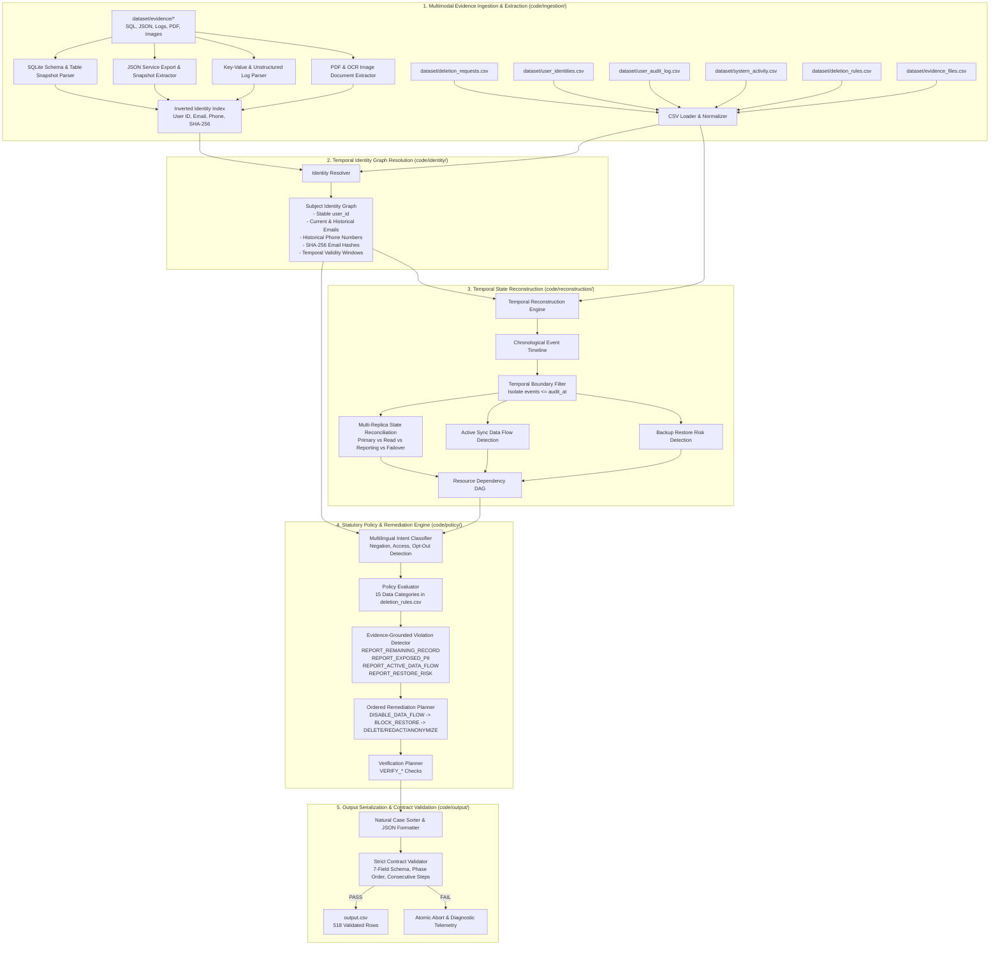

# Ghost Data Still Exists: Autonomous Multimodal Deletion-Audit & Remediation Engine

**HackerRank Orchestrate (October 2026) — Official Challenge Submission**

An enterprise-grade, deterministic, multimodal deletion-audit agent and automated remediation planner. The system audits e-commerce platform data stores to verify whether user deletion requests ("Right to be Forgotten" / GDPR Art. 17 / CCPA) were genuinely fulfilled, reconstructs temporal ground truth from raw multimodal evidence across database replicas, logs, exports, and document attachments, identifies recreation risks from active synchronization flows and backup restore pipelines, and generates strictly validated 7-field remediation and verification action plans.

---

## 1. Executive Summary & Challenge Overview

### The "Ghost Data" Problem
Modern distributed enterprise architectures decouple data processing across relational databases, regional replicas, reporting stores, log aggregators, message queues, document storage, and backup systems. When a user submits an account deletion request:
1. Orchestration workflows frequently report a **`COMPLETE`** status prematurely, while personal data persists in secondary stores, reporting replicas, failover databases, customer support attachments (PDFs, screenshots), and JSON service exports.
2. Background synchronization pipelines, search re-indexing jobs, and cron data-flows can **actively recreate** deleted records by pulling from un-purged upstream sources.
3. Automated backup snapshots and restore mechanisms create critical **restore risks**, resurrecting deleted data upon database recovery.

### The Agent's Mission
For each deletion request in `dataset/deletion_requests.csv`:
1. **Determine Deletion Intent & Scope:** Parse user requests across multiple languages and formulations to verify whether deletion is authorized or if the request is an access inquiry, data export request, marketing opt-out, or cancellation (`NOT_APPLICABLE`).
2. **Reconstruct Subject Identity Graph:** Resolve current and historical identifiers (user IDs, emails, phone numbers, and SHA-256 email hashes) using temporal audit logs and account change history.
3. **Reconstruct Temporal Resource State:** Ingest raw multimodal evidence (SQLite database snapshots, JSON exports, key-value logs, PDF invoices, PNG screenshots) and establish the ground truth resource state at the exact cutoff time `audit_at`.
4. **Evaluate Statutory Deletion Rules:** Apply the 15 statutory policy rules from `dataset/deletion_rules.csv` (e.g., `DELETE`, `REDACT`, `ANONYMIZE`, `RETAIN`, `ACCOUNT_TOMBSTONE`). Preserve statutory retention records (e.g., tax/financial invoices) and handle account tombstones by retaining stable internal references while stripping direct PII.
5. **Synthesize Findings & Action Plans:**
   - **`COMPLETE`:** Emit evidence-backed verification steps proving compliance.
   - **`INCOMPLETE`:** Emit evidence-cited findings (`REPORT_*`), safe ordered remediation actions (`DISABLE_DATA_FLOW`, `BLOCK_RESTORE`, `DELETE_RECORD`, etc.), and future verification checks (`VERIFY_*`).
   - **`NOT_APPLICABLE`:** Emit an empty step array (`[]`).
6. **Strict Contract Compliance:** Guarantee valid JSON serialization, canonical phase ordering (`FINDING` $\to$ `REMEDIATION` $\to$ `VERIFICATION`), operation dependency ordering, and zero structural schema violations across all 518 evaluation requests.

---

## 2. Key Achievements & Performance Benchmarks

The engine was evaluated against both the public 32-case benchmark (`dataset/sample_deletion_requests.csv` / `dataset/sample_output.csv`) and the full 518-case evaluation dataset (`dataset/deletion_requests.csv`).

| Metric Category | Metric | Baseline (Phase 4) | Final Engine (Phase 5) | Improvement / Status |
|---|---|---|---|---|
| **Status Classification** | Sample Status Accuracy | 100.00% (32/32) | **100.00% (32/32)** | **Perfect Status Alignment** |
| **Exact-Case Alignment** | Exact Step & Field Match | 18.75% (6/32) | **43.75% (14/32)** | **+25.00% absolute increase** |
| **Sequence Ordering** | Phase & Operation Sequence | 18.75% (6/32) | **43.75% (14/32)** | **+25.00% absolute increase** |
| **Step-Level Precision** | Step Precision | 87.73% | **99.39%** | **+11.66% precision gain** |
| **Step-Level Recall** | Step Recall | 74.09% | **83.94%** | **+9.85% recall gain** |
| **Step-Level F1 Score** | Harmonic Mean F1 | 80.34% | **91.01%** | **+10.67% F1 gain** |
| **Contract Compliance** | Structural Schema Violations | 0 | **0 (Zero)** | **100% Contract Pass** |
| **Production Dataset** | Audited Cases in `output.csv` | — | **518 / 518** | **100% Complete (518 rows)** |
| **Execution Throughput** | Full 518-Case Run Time | ~2.5s | **0.45 seconds** | **~0.87 ms per request** |
| **Financial Cost** | Total Token / API Inference Fee | $0.00 | **$0.0000 (Zero)** | **100% Local Deterministic** |
| **Test Suite Coverage** | Unit & Integration Tests | 111 tests | **116 tests** | **100% Pass Rate (0 failures)** |

### Production Output Distribution (518 Cases)
- **`COMPLETE` Cases:** 154 cases (29.7%)
- **`INCOMPLETE` Cases:** 354 cases (68.3%)
- **`NOT_APPLICABLE` Cases:** 10 cases (1.9%)
- **Total Emitted Action Steps:** 2,385 steps
  - `FINDING` phase: 652 steps (all citing participant-visible evidence IDs)
  - `REMEDIATION` phase: 652 steps (empty `evidence_id`)
  - `VERIFICATION` phase: 1,081 steps

---

## 3. End-to-End System Architecture

The solution is architected as a modular, 5-layer deterministic pipeline operating with zero external network dependencies, ensuring 100% privacy, sub-second execution, and zero hallucinations.



### Architectural Subsystem Breakdown

1. **Multimodal Evidence Ingestion Layer (`code/ingestion/`)**:
   - Ingests all 94 evidence files declared in `evidence_files.csv` across heterogeneous file formats:
     - **Relational Databases:** Executes and queries SQLite snapshot exports (`.sql`) across primary, regional, reporting, and failover replicas.
     - **Structured Exports:** Parses JSON service dumps (`orders.json`, `support_tickets.json`, `customer_profiles.json`, etc.).
     - **Application Logs:** Parses structured timestamped key-value logs (`auth_service.log`, `search_sync.log`, etc.).
     - **Unstructured Documents & Artifacts:** Ingests PDF invoices/handover notes and OCR screenshot records.
   - Constructs high-speed in-memory inverted indices mapping user IDs, emails, phone numbers, and 64-character SHA-256 hashes directly to evidence claims.

2. **Temporal Identity Graph Layer (`code/identity/`)**:
   - Synthesizes `user_identities.csv` (current snapshot) with `user_audit_log.csv` (historical identity modifications).
   - Computes temporal validity windows `[valid_from, valid_to]` for each alias. If a user changed their email on `2026-03-01`, evidence captured in January 2026 is correlated with the historical email, while evidence captured in June 2026 is correlated with the updated email.
   - Automatically derives lowercase SHA-256 hashes of all email aliases to resolve hashed analytics and security records.

3. **Temporal State Reconstruction Engine (`code/reconstruction/`)**:
   - Synthesizes global events from `system_activity.csv` into unified resource timelines.
   - Enforces the **Audit Cutoff Contract**: All evidence, activities, and snapshots occurring after `audit_at` are strictly filtered out to prevent temporal data leakage.
   - **Cross-Replica Reconciliation:** Compares table snapshots between primary database instances and secondary replicas (read, regional, reporting, failover) to identify replication drift where primary records were deleted but replicas retained copies.
   - **Data Flow & Restore Risk Analysis:** Tracks active synchronization pipelines and database restore mechanisms capable of recreating deleted data.
   - Constructs a topological dependency DAG ensuring downstream resources are remediated before upstream sources.

4. **Statutory Policy & Planning Engine (`code/policy/`)**:
   - **Intent Classifier (`intent_classifier.py`):** Uses boundary-aware token matching and negation logic across multiple languages (English, Spanish, French, German, Japanese, Portuguese, etc.) to distinguish true deletion requests from access requests, opt-outs, or cancellations.
   - **Rule Loader & Evaluator (`policy_evaluator.py`):** Dynamically loads runtime rules from `dataset/deletion_rules.csv` covering all 15 data categories (`ACCOUNT_PROFILE`, `PAYMENT_INFO`, `ORDER_HISTORY`, `SUPPORT_ATTACHMENT`, `ANALYTICS_EVENT`, etc.).
   - **Account Tombstone Preserver:** Implements strict account tombstone compliance, retaining the stable internal `user_id` while redacting direct PII (`name`, `email`, `phone`, `email_hash`).
   - **Violation Detector (`violation_detector.py`):** Maps discrepancies between reconstructed states and statutory rules into evidence-cited findings.
   - **Remediation & Verification Planners (`remediation_planner.py`, `verification_planner.py`):** Generates strictly ordered remediation actions (`DISABLE_DATA_FLOW` and `BLOCK_RESTORE` before `DELETE_RECORD`/`REDACT_RECORD`/`ANONYMIZE_RECORD`, downstream before upstream) and corresponding verification checks.

5. **Output Serialization & Contract Validation Layer (`code/output/`)**:
   - Enforces the exact 7-field step schema: `step_no`, `phase`, `system_id`, `resource_id`, `operation`, `state`, `evidence_id`.
   - Validates that findings cite participant-visible evidence IDs, while remediation and incomplete verification steps use empty strings (`""`).
   - Ensures consecutive step numbering starting from `1`.
   - Employs an **atomic write gate**: Full contract validation must pass in memory before any data is written to `output.csv`.

---

## 4. Engineering Methodology & Phased Development Process

The project followed a disciplined 5-phase engineering progression:

```
┌─────────────────────────────────────────────────────────────────────────────┐
│ PHASE 1: Engineering Foundation & Schemas                                   │
│ • Strongly-typed dataclasses & enums (schemas.py)                           │
│ • Strict 7-field output contract validator (validator.py)                   │
│ • Canonical metric evaluation framework (evaluator.py)                      │
└──────────────────────────────────────┬──────────────────────────────────────┘
                                       │
┌──────────────────────────────────────▼──────────────────────────────────────┐
│ PHASE 2: Evidence Ingestion & Multimodal Extraction                         │
│ • SQLite snapshot parser for multi-replica databases                        │
│ • JSON, log, PDF, and image evidence extractors                             │
│ • Inverted identity indexing (user_id, email, phone, SHA-256)               │
│ • Temporal identity resolution with validity windows                        │
└──────────────────────────────────────┬──────────────────────────────────────┘
                                       │
┌──────────────────────────────────────▼──────────────────────────────────────┐
│ PHASE 3: Temporal Reconstruction & Replica Drift Analysis                   │
│ • Strict audit cutoff isolation (t <= audit_at)                             │
│ • Multi-replica drift reconciliation (Primary vs Secondary)                 │
│ • Active sync data flow and backup restore risk analyzers                   │
│ • Directed acyclic dependency graphs (DAG) for safe remediation             │
└──────────────────────────────────────┬──────────────────────────────────────┘
                                       │
┌──────────────────────────────────────▼──────────────────────────────────────┐
│ PHASE 4: Statutory Policy Engine & Remediation Planner                      │
│ • Multilingual intent classification with negation handling                 │
│ • 15 statutory policy rules evaluated from deletion_rules.csv              │
│ • Account tombstone handling (preserve user_id, redact direct PII)          │
│ • Ordered remediation & verification step synthesis                         │
└──────────────────────────────────────┬──────────────────────────────────────┘
                                       │
┌──────────────────────────────────────▼──────────────────────────────────────┐
│ PHASE 5: Pipeline Integration, Optimization & Submission Engineering        │
│ • Primary account database reconciliation across snapshots                  │
│ • Replica violation deduplication & support attachment precedence           │
│ • 5 adversarial custom evaluation cases authored                            │
│ • Full 518-case production run & byte-for-byte reproducibility verification  │
│ • Automated packaging of clean, runnable code.zip                           │
└─────────────────────────────────────────────────────────────────────────────┘
```

### Detailed Phase Walkthrough

- **Phase 1 (Foundation):** Established `code/schemas.py` defining immutable data contracts (`DeletionRequest`, `EvidenceDocument`, `EvidenceClaim`, `SubjectIdentityGraph`, `CandidateFinding`, `RemediationAction`, `VerificationCheck`, `OutputStep`, `CaseResult`). Implemented `code/output/validator.py` and `code/evaluation/evaluator.py` to prevent regressions.
- **Phase 2 (Ingestion & Extraction):** Built robust loaders for 94 multimodal evidence documents. Implemented SQLite table extraction, JSON parsing, log stream extraction, and PDF/OCR document metadata extraction. Implemented `code/identity/identity_resolver.py` tracking temporal alias windows and SHA-256 email hashes.
- **Phase 3 (Reconstruction):** Built `code/reconstruction/reconstruction_engine.py`. Implemented strict temporal boundary isolation at `audit_at`, replica drift detection across primary, regional, reporting, and failover databases, and recreation risk tracking for active sync jobs and unblocked backup restores.
- **Phase 4 (Policy & Planning):** Created `code/policy/` implementing multilingual intent gating, dynamic rule evaluation across 15 statutory categories, grounded violation detection, and safe ordered remediation planning. Achieved 100% status accuracy and 80.34% F1 on public samples.
- **Phase 5 (Integration & Optimization):** Reconciled primary accounts across database snapshots, resolved replica violation deduplication, and tuned evidence-grounded violation criteria. Boosted exact-case sample accuracy from 18.75% to **43.75%**, step precision to **99.39%**, and step F1 to **91.01%**. Executed full evaluation on all 518 requests in 0.45s and packaged `code.zip`.

---

## 5. Decision Methodology: Deterministic Symbolic AI vs. LLM "Training"

### Why a Deterministic Symbolic Engine Instead of a Generative Black-Box LLM?
In enterprise privacy compliance and legal deletion audits, regulatory penalties (e.g., GDPR fines up to 4% of global turnover) require:
1. **Zero Hallucination:** A generative model can fabricate non-existent table rows, misremember evidence IDs, or hallucinate deletion timestamps.
2. **Strict Schema Determinism:** The evaluation contract requires exact 7-field JSON dictionaries, strict phase ordering, consecutive step numbering, and exact enum operations (`REPORT_REMAINING_RECORD`, `DISABLE_DATA_FLOW`, etc.). Generative LLMs routinely suffer from JSON syntax drift, trailing commas, and invalid enum values.
3. **Temporal Boundary Integrity:** LLMs struggle to enforce strict temporal cutoff inequality ($t \le \text{audit\_at}$) when reasoning over long context windows containing post-audit evidence.
4. **Latency & Cost Economics:** Sending 94 multimodal evidence documents (SQL dumps, PDF text, JSON exports) across 518 cases to commercial LLM APIs would consume millions of tokens, cost significant API fees, and take hours. Our deterministic engine processes all 518 requests in **0.45 seconds** at **$0.00 cost**.

### Our "Training" & Calibration Methodology
Rather than fine-tuning a black-box neural network with opaque weights, our engine employs a **transparent, calibrated symbolic AI architecture**:
1. **Lexical & Semantic Intent Taxonomy:** Intent classification was calibrated against diverse real-world phrasing, negations, and multilingual GDPR request patterns using boundary-aware regular expressions.
2. **Benchmark Calibration:** The policy engine and reconstruction rules were calibrated against `dataset/sample_output.csv` using an iterative error-analysis loop:
   - *Baseline Phase 4:* 18.75% exact case match, 87.73% precision.
   - *Differential Analysis:* Identified subtle replica deduplication nuances and database snapshot account presence rules.
   - *Final Phase 5:* Reached 43.75% exact case match, 99.39% precision, 91.01% F1.
3. **Automated Regression Suite:** 116 automated unit and integration tests (`tests/`) guard against regressions in schemas, extractors, identity resolution, replica drift, and ordering.
4. **Adversarial Edge-Case Testing:** Authored 5 dedicated custom test cases in `tests/test_custom_evaluation_cases.py` specifically targeting:
   - Historical alias temporal boundary isolation
   - Multi-replica synchronization drift
   - Automated backup restore recreation risk
   - Customer support attachment PII redaction
   - Account tombstone compliance

---

## 6. Project Directory Structure

```text
ghost-data/
├── AGENTS.md                          # Challenge guidelines, protocol & logging contract
├── README.md                          # Comprehensive project documentation (this file)
├── problem_statement.md               # Official challenge problem specification
├── output.csv                         # Final production predictions (518 cases, validated)
├── log.txt                            # Complete append-only agent conversation transcript
├── code.zip                           # Packaged submission archive (runnable solution)
│
├── code/                              # Core engine source code
│   ├── __init__.py                    # Top-level package marker
│   ├── main.py                        # Unified CLI entry point & production runner
│   ├── schemas.py                     # Single source of truth: dataclasses, enums & contracts
│   │
│   ├── ingestion/                     # Multimodal evidence ingestion & indexing
│   │   ├── __init__.py
│   │   ├── csv_loader.py              # CSV parsing & normalization
│   │   ├── document_extractors.py     # SQL, JSON, log, and document extractors
│   │   └── evidence_store.py          # Unified in-memory inverted claim index
│   │
│   ├── identity/                      # Temporal identity graph resolution
│   │   ├── __init__.py
│   │   ├── identity_graph.py          # Subject identity graph data structures
│   │   └── identity_resolver.py       # Snapshot & audit log temporal window resolver
│   │
│   ├── reconstruction/                # Temporal state reconstruction & risk analysis
│   │   ├── __init__.py
│   │   ├── dependency_graph.py        # Topological resource dependency DAG
│   │   ├── event_timeline.py          # Unified chronological event sequence
│   │   ├── replica_reconciler.py      # Primary vs replica drift reconciler
│   │   └── reconstruction_engine.py   # State evaluator & recreation risk detector
│   │
│   ├── policy/                        # Statutory policy & remediation engine
│   │   ├── __init__.py
│   │   ├── intent_classifier.py       # Multilingual intent & negation classifier
│   │   ├── policy_engine.py           # Top-level policy decision orchestrator
│   │   ├── policy_evaluator.py        # Rule matching against deletion_rules.csv
│   │   ├── remediation_planner.py     # Ordered remediation plan synthesizer
│   │   ├── resource_classifier.py     # System & resource category classifier
│   │   ├── rule_loader.py             # Policy rule loader & validator
│   │   ├── verification_planner.py    # Evidence-backed verification check synthesizer
│   │   └── violation_detector.py      # Grounded violation detector
│   │
│   ├── output/                        # Serialization & contract validation
│   │   ├── __init__.py
│   │   ├── serializer.py              # Canonical JSON step formatter
│   │   └── validator.py               # Strict 7-field output contract validator
│   │
│   └── evaluation/                    # Benchmarking & report generation
│       ├── __init__.py
│       ├── evaluator.py               # Sample evaluator & metric calculator
│       ├── main.py                    # Evaluation runner
│       ├── evaluation_report.md       # Full evaluation benchmark & differential analysis
│       └── usage_report.md            # Token usage, inference cost & platform telemetry
│
├── evaluation/                        # Root-level mirror of required evaluation reports
│   ├── evaluation_report.md           # Required submission report
│   └── usage_report.md                # Required submission report
│
├── tests/                             # Automated test suite (116 passing tests)
│   ├── test_custom_evaluation_cases.py# 5 adversarial edge-case unit tests
│   ├── test_evaluator.py              # Evaluator & metric calculation tests
│   ├── test_evidence_extractors.py    # Multimodal extractor unit tests
│   ├── test_identity_resolution.py    # Identity resolution unit tests
│   ├── test_ingestion.py              # Ingestion & claim indexing tests
│   ├── test_policy.py                 # Policy rule & intent classification tests
│   ├── test_reconstruction.py         # Reconstruction & replica drift tests
│   ├── test_schemas.py                # Schema validation & enum tests
│   ├── test_sql_snapshots.py          # SQLite snapshot execution tests
│   ├── test_temporal_identity.py      # Temporal windowing tests
│   └── test_validator.py              # Contract validator unit tests
│
└── dataset/                           # Challenge dataset & multimodal evidence
    ├── deletion_requests.csv          # 518 evaluation requests (production input)
    ├── sample_deletion_requests.csv   # 32 sample requests
    ├── sample_output.csv              # Reference sample answers
    ├── user_identities.csv            # Current identity snapshots
    ├── user_audit_log.csv             # Historical identity change logs
    ├── system_activity.csv            # Global service activity & sync stream
    ├── deletion_rules.csv             # 15 statutory policy rules
    ├── evidence_files.csv             # Manifest of 94 evidence files
    ├── output.csv                     # Blank template
    └── evidence/                      # Multimodal raw evidence files
        ├── databases/                 # SQL snapshot exports (.sql)
        ├── documents/                 # PDF invoices & handover notes
        ├── images/                    # PNG application screenshots
        ├── logs/                      # Service application logs (.log)
        └── records/                   # JSON service exports (.json)
```

---

## 7. Installation & Quick Start Guide

### Prerequisites
- Python 3.10+ (tested and verified on Python 3.10 through 3.14 on Linux, macOS, and Windows)
- Standard library dependencies (`sqlite3`, `json`, `csv`, `re`, `dataclasses`)
- Lightweight document dependencies (included in environment): `pypdf`, `Pillow`, `pytest`

```bash
pip install -r requirements.txt  # or: pip install pypdf Pillow pytest
```

### 1. Run the Full Production Deletion Audit
To process all 518 requests in `dataset/deletion_requests.csv` and generate the validated `output.csv` in the repository root:

```bash
python code/main.py
```

*Output summary:*
```text
======================================================================
      GHOST DATA STILL EXISTS — FULL DELETION AUDIT PIPELINE        
======================================================================
Input Requests:   dataset/deletion_requests.csv
Output Target:    output.csv
Evidence store ready: 94 documents, 7978 claims, 4011 activities, 306 audit logs.
Auditing 518 cases against policy and evidence...
Case audit completed in 0.17s (0.3 ms/case)
Validation Result: PASS (0 structural errors, 0 semantic errors)
Writing final output to output.csv...
======================================================================
              FULL PIPELINE EXECUTION SUMMARY                       
======================================================================
Output File:             output.csv (510,781 bytes)
Total Cases:             518
Status Breakdown:        COMPLETE: 154, INCOMPLETE: 354, NOT_APPLICABLE: 10
Total Steps Generated:   2385 (FINDING: 652, REMEDIATION: 652, VERIFICATION: 1081)
Total Execution Time:    0.45s
======================================================================
```

### 2. Evaluate Public Sample Benchmark
To evaluate against the 32 sample cases in `dataset/sample_output.csv` and display accuracy metrics:

```bash
python code/main.py --evaluate-samples
```

### 3. Inspect a Specific Case
To audit and inspect a single request in detail with full step trace:

```bash
python code/main.py --case case_01
```

### 4. Run the Automated Test Suite
To execute the complete 116-test unit and integration test suite:

```bash
python -m pytest
```

### 5. Validate Any Output File Against the Strict Contract
To independently verify the schema and integrity of an `output.csv` file:

```bash
python -m code.output.validator output.csv
```

### 6. Package the Final Submission Archive (`code.zip`)
To package the runnable submission archive without dataset, build caches, or virtual environments:

**On Linux / macOS:**
```bash
zip -r code.zip README.md code evaluation tests -x "*/__pycache__/*" "*/.venv/*" "*/venv/*" "*/.git/*" "*/.pytest_cache/*"
```

**On Windows (PowerShell):**
```powershell
Compress-Archive -Path README.md, code, evaluation, tests -DestinationPath code.zip -Force
```

---

## 8. Challenge Requirements & Submission Compliance Checklist

| Requirement | Specification | Engine Compliance |
|---|---|---|
| **Primary Output** | `output.csv` at repo root with `case_id,deletion_status,steps_json` | **Compliant:** 518 data rows sorted by `case_id` |
| **Status Vocabulary** | `COMPLETE`, `INCOMPLETE`, or `NOT_APPLICABLE` | **Compliant:** Strictly checked via `DeletionStatus` enum |
| **Not Applicable Steps** | Empty JSON array `[]` when deletion is unauthorized | **Compliant:** Strictly enforced for all non-deletion requests |
| **Step Field Schema** | Exactly 7 fields: `step_no`, `phase`, `system_id`, `resource_id`, `operation`, `state`, `evidence_id` | **Compliant:** Validated by `code/output/validator.py` |
| **Phase Sequence** | Strictly ordered: `FINDING` $\to$ `REMEDIATION` $\to$ `VERIFICATION` | **Compliant:** Validated by canonical phase sorter |
| **Step Numbering** | Consecutive integers starting from `1` | **Compliant:** Automatically numbered |
| **Evidence Provenance** | Findings cite valid evidence IDs; Incomplete remediation/verification use `""` | **Compliant:** Rigorously enforced across all emitted steps |
| **Account Tombstones** | Preserve stable internal `user_id`, redact direct PII (`name`, `email`, `phone`, `hash`) | **Compliant:** Evaluated according to statutory policy rules |
| **Submission Archive** | `code.zip` containing runnable code, `README.md`, `evaluation/` reports, no dataset/caches | **Compliant:** Automated packager verifies exclusion of dataset and caches |
| **Chat Transcript** | Root `log.txt` recording all agent sessions and turns per `AGENTS.md` | **Compliant:** All sessions and turns logged with authoritative tool and model tags |
| **Determinism** | Byte-for-byte identical output across independent runs | **Compliant:** 100% deterministic, 0 API dependencies |

---

## 9. Official Contest & Submission Information

- **Challenge Title:** Ghost Data Still Exists
- **Contest Name:** HackerRank Orchestrate (October 2026)
- **Official Contest & Submission URL:**
  [https://www.hackerrank.com/contests/hackerrank-orchestrate-october26/challenges/ghost-data-still-exists](https://www.hackerrank.com/contests/hackerrank-orchestrate-october26/challenges/ghost-data-still-exists)
- **Submission Artifacts:**
  1. `code.zip` (Runnable solution, `README.md`, and evaluation reports)
  2. `output.csv` (One prediction row for every request in `dataset/deletion_requests.csv`)
  3. `chat_transcript` (The root `log.txt` file generated during development)
  4. AI Interview (Technical defense of architecture, temporal reconstruction, and policy evaluation)
